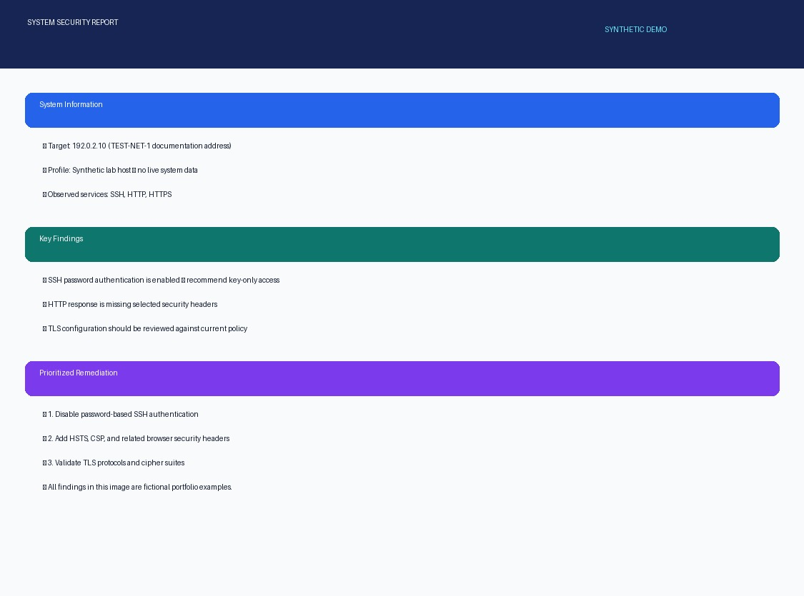
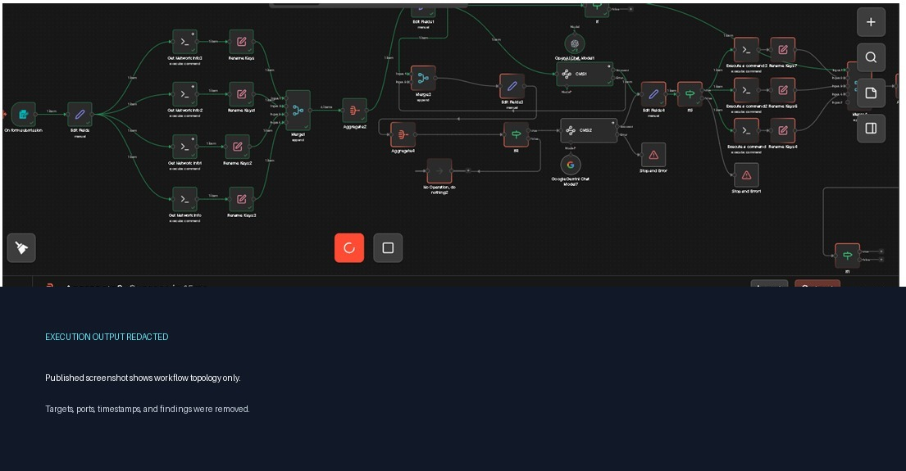
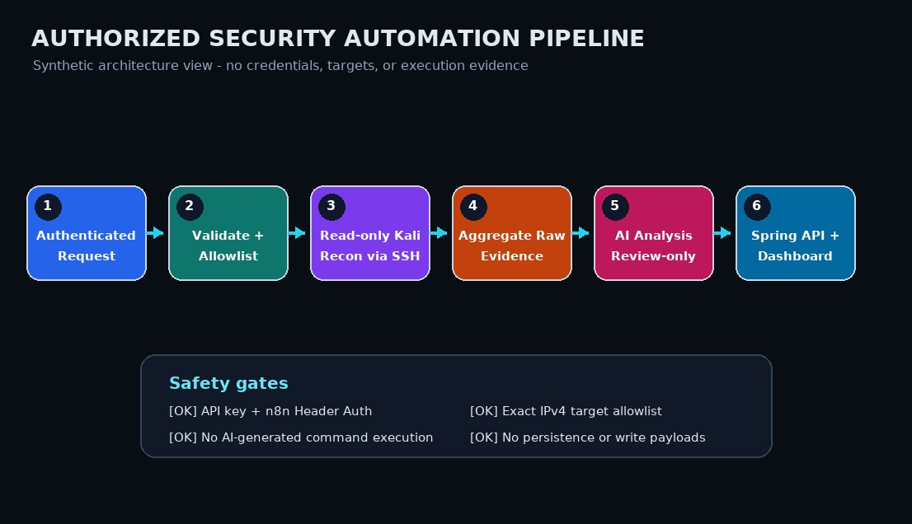

# Security Scan Automation — n8n + Spring Boot

[](https://github.com/Pawan947/Security-scan-automation-n8n-/actions/workflows/ci.yml)
[](SECURITY.md)
[](LICENSE)

Automated security reconnaissance pipeline powered by **n8n** workflows
orchestrating Kali Linux tools over SSH, with AI-powered analysis via
Google Gemini and OpenAI, and a Spring Boot backend for ingesting and
viewing scan results.

---

## Overview

This project automates network security scanning and vulnerability
reconnaissance. It combines three layers:

1. **n8n workflow** — Orchestrates SSH-based Kali tool execution on a
   target host, collects outputs, sends them to AI models for analysis,
   and posts structured results to the Spring Boot backend.
2. **Spring Boot backend (`Sec`)** — A lightweight REST API that
   receives scan results from n8n and serves them to a web dashboard.
   Uses an in-memory store (easily replaceable with a real database).
3. **Kali bash scripts** — Standalone reconnaissance scripts in
   `linux bash/` that the n8n workflow invokes over SSH. Covers port
   discovery, service fingerprinting, DNS, SMB, SNMP, web enumeration,
   and more.

The n8n workflow (`automation n8n/Agent_u01 6.json`) is the heart of
the system. It starts from a form trigger or webhook, runs a series of
SSH commands on the Kali host, merges and aggregates the results, sends
them through Google Gemini / OpenAI for structured analysis and attack
path reasoning, and delivers the final output to the Spring Boot API.

---

## Architecture

```
 User / Dashboard
       |
       v
 Spring Boot (localhost:8080)
   /send           POST  { ipaddress, port }  --> triggers scan
   /api/scan-results
     POST          receive scan result from n8n
     GET /latest   poll for latest result

       ^
       | HTTP POST (scan results)
       |
 n8n Workflow (localhost:5678)
   Form trigger / Webhook
   SSH nodes -> Kali scripts (device_info.sh, dns.sh, services.sh,
                        auto.sh, bandwidth.sh)
   AI nodes   -> Google Gemini, OpenAI GPT
   HTTP Request -> POST to Spring Boot /api/scan-results
```

### n8n workflow flow

1. **Trigger** — Form submission or webhook (`9110577a-...`) with target
   IP and port.
2. **SSH reconnaissance** — Runs `device_info.sh`, `dns.sh`,
   `services.sh`, `auto.sh`, `bandwidth.sh` on the Kali host.
3. **Aggregation** — Merges all SSH outputs into a single payload.
4. **AI analysis** — Sends the aggregated data through Google Gemini
   and/or OpenAI GPT for structured extraction: system info, key
   findings, attack paths, evidences, risk percentage.
5. **Delivery** — Posts the final JSON output to the Spring Boot
   `/api/scan-results` endpoint.

### Spring Boot API

| Endpoint | Method | Description |
|----------|--------|-------------|
| `/send` | POST | Accepts `{ ipaddress, port }`, forwards to n8n webhook |
| `/api/scan-results` | POST | Receives scan result JSON from n8n |
| `/api/scan-results/latest` | GET | Returns the latest scan result (204 if none) |

---

## Project Structure

```
Security-scan-automation-n8n-/
├── pom.xml                          # Maven build config (Spring Boot 4.1.0, Java 17)
├── .gitignore
├── .gitattributes
├── src/main/java/org/automate/sec/
│   ├── SecApplication.java          # Spring Boot entry point
│   ├── ApiService.java              # Outbound API client (forwards to n8n)
│   ├── RequestData.java             # DTO: { ipaddress, port }
│   ├── ScanResultController.java    # REST endpoints for scan results
│   ├── ScanResultStore.java         # In-memory result store
│   ├── SendController.java          # /send endpoint — triggers n8n webhook
│   └── StartupRunner.java           # Optional startup request (disabled by default)
├── src/main/resources/
│   ├── application.properties       # Environment-driven API/webhook config
│   └── static/index.html            # Web dashboard (SynkScreen UI)
├── src/test/java/org/automate/sec/
│   └── SecApplicationTests.java     # Context load test
├── automation n8n/
│   └── Agent_u01 6.json             # The n8n workflow (export)
└── linux bash/
    ├── auto.sh                      # Aggressive multi-service pentest script
    ├── bandwidth.sh                 # Bandwidth/network info
    ├── device_info.sh               # Device/service fingerprinting
    ├── devices.sh                   # Device enumeration
    ├── dns.sh                       # DNS reconnaissance
    ├── services.sh                  # Service enumeration
    ├── env.example                  # Placeholder worker environment config
    └── install.ps1                  # Windows install script
```

---

## Screenshots

### System Security Report



A fully synthetic report used to demonstrate the dashboard layout without publishing a real target, port inventory, or exploit evidence. The documentation-only `192.0.2.0/24` TEST-NET range is used deliberately.

### n8n Workflow — Aggregate2 Execution



n8n node-based workflow editor showing the parallel service-fingerprinting topology. The execution-output panel is intentionally redacted so public documentation does not expose target addresses, ports, timestamps, or findings.

### Sanitized Architecture View



Synthetic architecture diagram of the published safety model: authenticated requests, exact target allowlisting, read-only reconnaissance, evidence aggregation, review-only AI analysis, and report delivery. It contains no live workflow data or credentials.

---

## n8n Workflow (`Agent_u01 6.json`)

The workflow is exported as a JSON file ready to import into any n8n
instance. It uses the following node types:

| Category | Nodes used |
|----------|-----------|
| Triggers | `formTrigger`, `webhook` |
| Execution | `ssh` (multiple — runs Kali scripts over SSH) |
| Data manipulation | `set`, `editFields`, `renameKeys`, `merge`, `aggregate` |
| Logic | `if` (conditional branches on errors / risk thresholds) |
| AI / LLM | `lmChatGoogleGemini`, `lmChatOpenAi`, `agent`, `informationExtractor` |
| Memory | `memoryManager` (conversation state across phases) |
| Output | `httpRequest` (posts to Spring Boot), `html` (renders report) |
| Control | `stopAndError`, `noOp` |

### AI analysis phases

The workflow sends scan data through two AI pipelines:

- **Google Gemini** — Extracts structured fields: `cmd1/2/3`, `risk
  percentage`, system info, key findings, attack paths, evidences.
- **OpenAI GPT-OSS-120B / GPT-OSS-20B** — Senior penetration tester
  reasoning engine. Processes raw scan data through a multi-step
  reasoning chain: observations → inferences → reasoning chains →
  exploitability analysis → attack path construction → priority ranking
  → assumptions & unknowns → analyst summary.

The AI nodes are configured with detailed system prompts that enforce
structured output and forbid raw exploit code generation. **AI-generated
commands are never executed by the published workflow**; recommendation
nodes produce review-only text. SSH execution nodes accept only validated
IPv4/port expressions, use `sudo -n`, and require narrowly scoped
passwordless sudo to be configured on the authorized Kali worker.

### SSH credentials

The workflow connects to the Kali host via SSH using credentials stored
in n8n (not in the JSON file). The workflow references:
- **SSH Password account** (`AdDirGY1pBRQRCwJ`) — stored in n8n
  credentials, not in the exported workflow file.

When importing the workflow into a new n8n instance, re-create or
re-link the SSH credential.

---

## Spring Boot Backend

A minimal Spring Boot 4.1.0 application (Java 17) that acts as the
result ingestion point for the n8n workflow.

### Dependencies

- Spring Boot 4.1.0 (parent)
- Spring Boot H2 Console (dev database UI at `/h2-console`)
- Spring Boot JDBC
- Spring Web (REST controllers)

### Configuration

All config is in `src/main/resources/application.properties`:

```properties
spring.application.name=SecurityScanAutomation
api.url=${API_URL:http://localhost:5000/api}
n8n.webhook.url=${N8N_WEBHOOK_URL:http://localhost:5678/webhook-test/...}
n8n.webhook.token=${N8N_WEBHOOK_TOKEN:}
scan.api.key=${SCAN_API_KEY:}
scan.allowed.targets=${SCAN_ALLOWED_TARGETS:}
app.startup-request.enabled=${STARTUP_REQUEST_ENABLED:false}
```

- `API_URL` — Optional URL used by `ApiService` for outbound requests.
- `N8N_WEBHOOK_URL` — n8n webhook receiving validated scan requests.
- `N8N_WEBHOOK_TOKEN` — Secret forwarded in `X-N8N-Webhook-Token`; configure the imported n8n Header Auth credential with the same header/value.
- `SCAN_API_KEY` — Required client key for the Spring `/send` endpoint.
- `SCAN_ALLOWED_TARGETS` — Required comma-separated exact IPv4 allowlist; an empty value denies every target.
- `STARTUP_REQUEST_ENABLED` — Opt-in startup request; disabled by default to prevent unexpected network activity.

### Running

```bash
# Build and run
mvn spring-boot:run

# Or build a JAR and run
mvn package
java -jar target/security-scan-automation-0.1.0-SNAPSHOT.jar
```

The app starts on port 8080 by default (Spring Boot default). Adjust
with `server.port` in `application.properties` if needed.

### Endpoints

**POST /send**

Triggers a scan by forwarding the request to the n8n webhook.

```bash
curl -X POST http://localhost:8080/send \
  -H "Content-Type: application/json" \
  -H "X-Scan-API-Key: $SCAN_API_KEY" \
  -d '{"ipaddress":"192.168.1.10","port":"8080"}'
```

**POST /api/scan-results**

Receives scan results from the n8n workflow.

```bash
curl -X POST http://localhost:8080/api/scan-results \
  -H "Content-Type: application/json" \
  -H "X-N8N-Webhook-Token: $N8N_WEBHOOK_TOKEN" \
  -d '{"output": {...}}'
```

**GET /api/scan-results/latest**

Polls for the latest scan result. Returns 204 No Content if no results
exist yet.

```bash
curl -H "X-Scan-API-Key: $SCAN_API_KEY" \
  http://localhost:8080/api/scan-results/latest
```

### Web dashboard

`src/main/resources/static/index.html` is a self-contained SynkScreen UI
— a dark-themed dashboard with:

- A scan launch form (target IP + port)
- Polling for results from `/api/scan-results/latest`
- Rendered system info, key findings, attack paths, and evidences
- Status badge (waiting / polling / results ready)

Open `http://localhost:8080/` in a browser to use the dashboard.

---

## Kali Bash Scripts

The `linux bash/` directory contains standalone reconnaissance scripts
that the n8n workflow invokes over SSH. They are designed to run on
Kali Linux with root privileges.

| Script | Purpose |
|--------|---------|
| `device_info.sh` | Phase 2: service & OS fingerprinting — nmap -sV -O with banner/ssl scripts |
| `dns.sh` | Phase 4: deep DNS checks — zone transfer, subdomain brute, recursion, tunnel detection |
| `services.sh` | Service enumeration across open ports |
| `bandwidth.sh` | Network bandwidth / connectivity info |
| `auto.sh` | Phase 4: aggressive multi-service pentest — web (nikto, feroxbuster, wfuzz, nuclei, whatweb), SMB (crackmapexec, smbmap, Impacket), SNMP (onesixtyone, snmp-check), RDP (BlueKeep, crowbar), DNS (dnsrecon), MSSQL, MySQL, PostgreSQL, SSH, FTP, Redis, and more |

### Script conventions

- All scripts require root (`EUID -ne 0` check).
- Take target IP as `$1`.
- Use aggressive nmap timing (`-T4`/`-T5`, high `--min-rate`).
- Parallel execution where possible via background jobs (`&`) + `wait`.
- Output to stdout; `auto.sh` additionally writes structured output to
  `/tmp/phase4_<TARGET>_<ts>/`.

### Tools used by scripts

nmap, masscan, zmap, feroxbuster, wfuzz, nikto, whatweb, nuclei,
crackmapexec, smbmap, samrdump, netview, onesixtyone, snmp-check,
dnsrecon, crowbar, hydra, nmap NSE scripts (service-specific),
Impacket tools, redis-cli, psql, mysql, curl, dig, nc, swaks.

---

## Setup

### Prerequisites

- **n8n** instance (self-hosted or n8n cloud) — to import and run the
  workflow.
- **Kali Linux** host accessible via SSH from the n8n instance — runs
  the bash scripts.
- **Java 17+** and **Maven** — to build and run the Spring Boot backend.
- **SSH credential** in n8n configured for the Kali host.

### Import the n8n workflow

1. Open your n8n instance.
2. Go to **Settings → Import from File** (or use the import button).
3. Select `automation n8n/Agent_u01 6.json`.
4. Re-link the SSH credential (`AdDirGY1pBRQRCwJ` reference) to your
   actual Kali SSH credential.
5. Create/re-link the `Scan Webhook Header Auth` credential using header
   `X-N8N-Webhook-Token` and the same value as `N8N_WEBHOOK_TOKEN`.
6. Re-link the Google Gemini and OpenAI credentials if they differ from
   the original n8n instance.
7. Activate the workflow.

### Run the Spring Boot backend

```bash
cd Security-scan-automation-n8n-
mvn spring-boot:run
```

The backend starts on `http://localhost:8080`. The dashboard is at
`http://localhost:8080/`.

If your n8n instance is not on localhost, set environment variables before startup:

```bash
export API_URL="http://your-downstream-api:5000/api"
export N8N_WEBHOOK_URL="http://your-n8n-instance:5678/webhook/your-id"
export N8N_WEBHOOK_TOKEN="generate-a-long-random-value"
export SCAN_API_KEY="generate-another-long-random-value"
export SCAN_ALLOWED_TARGETS="192.168.1.10,192.168.1.20"
mvn spring-boot:run
```

`POST /send` validates IPv4 addresses and ports before forwarding the request. Keep n8n and the backend behind authentication and a target allowlist before exposing them outside a lab.

### Configure the n8n → backend connection

The n8n workflow's final HTTP Request node posts to:

```
http://localhost:8080/api/scan-results
```

If the Spring Boot backend runs on a different host/port, update this
node in the n8n workflow after import.

---

## Usage

### Launch a scan via the dashboard

1. Open `http://localhost:8080/`.
2. Enter target IP and port.
3. Click **Initiate Scan**.
4. The dashboard polls `/api/scan-results/latest` every 3 seconds.
5. When n8n finishes, results appear: system info, key findings, attack
   paths, evidences.

### Launch a scan via curl

```bash
curl -X POST http://localhost:8080/send \
  -H "Content-Type: application/json" \
  -H "X-Scan-API-Key: $SCAN_API_KEY" \
  -d '{"ipaddress":"192.168.1.10","port":"8080"}'
```

Then poll:

```bash
watch -n 3 'curl -s -H "X-Scan-API-Key: '"$SCAN_API_KEY"'" http://localhost:8080/api/scan-results/latest | python3 -m json.tool'
```

### Run scripts directly on Kali

```bash
# Device fingerprinting
sudo ./device_info.sh 192.168.1.10

# DNS reconnaissance
sudo ./dns.sh 192.168.1.10

# Aggressive full scan
sudo ./auto.sh 192.168.1.10
```

---

## Security Notes

### Credentials

- **n8n credentials are not stored in the exported workflow file.**
  The workflow JSON references credential IDs (`AdDirGY1pBRQRCwJ`,
  `vEyQuV79M8XIltB7`, `hW4rRAFcCsACYJkV`) but not actual passwords,
  API keys, or tokens. When importing into a new n8n instance, you must
  re-create or re-link these credentials.
- **Do not commit real credentials** to this repository. The n8n
  workflow file contains only credential ID references.

### SSH access

- The Kali host must be accessible from the n8n instance via SSH.
- The scripts require root on Kali. The n8n SSH node runs commands with
  `sudo -S` using the SSH user's password.
- Ensure the SSH credential in n8n has sufficient privileges on the
  Kali host.

### API exposure

- The Spring Boot backend has no authentication. Do not expose
  `/send` or `/api/scan-results` to the public internet without adding
  auth middleware.
- The H2 console (`/h2-console`) is enabled by default. Disable it in
  production by removing `spring-boot-h2console` from `pom.xml` or
  setting `spring.h2.console.enabled=false`.

### Responsible use

- These scripts perform active network scanning. Only run them against
  systems you own or have explicit permission to test.
- `auto.sh` is aggressive — it runs parallel nmap, crackmapexec,
  brute-force attempts, and vulnerability scanning across many service
  types. Use with caution.

---

## License

MIT License — see [LICENSE](LICENSE) for details.

---

## Author

Pawan Yadav ([@Pawan947](https://github.com/Pawan947))
